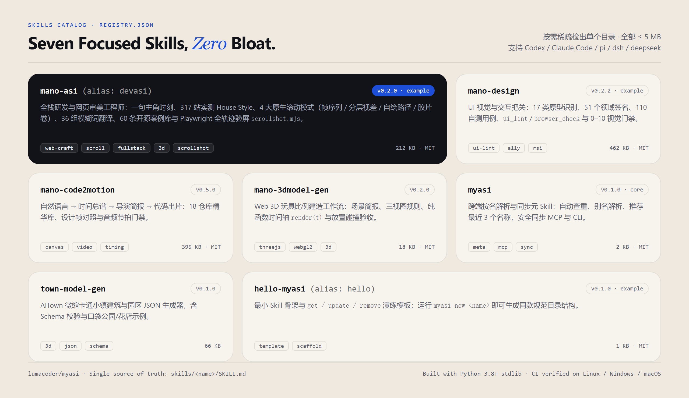

<div align="center">

# myasi

**一个仓库，按名同步你的全部 AI Agent Skills、MCP 配置与 CLI 清单。**

[](https://github.com/lumacoder/myasi/actions/workflows/ci.yml)


[快速开始](#-快速开始) · [内置 Skills](#-内置-skills-全景) · [常用命令与支持端](#-常用命令与支持端) · [使用与开发指南](docs/GUIDE.md) · [架构设计](docs/DESIGN.md)

<br />


</div>

---

> **寓意：我的超级人工智能（My ASI）。**  
> 换电脑或切换编程 Agent 时，只需说出裸名（如 `mano-asi`），`myasi` 自动稀疏检出单个目录并跨端链接就位，零第三方依赖、不落地明文密钥。

## ✨ 核心特性

- **单一总仓（Monorepo）**：统一托管自有 `skills/`、第三方索引 `catalog/external.yaml`、`mcp/servers.yaml` 与 `cli/` 装机清单。
- **只说裸名，按需单目录拉取**：`registry.json` 解析裸名与别名（如 `devasi → mano-asi`）；有 `git` 走 `--filter=blob:none` 稀疏检出，无 `git` 自动走 tarball 单目录解压。
- **Python 3.8+ 零依赖**：单文件标准库实现，Windows（免管理员 `mklink /J`，失败自动回退拷贝）、macOS、Linux 全兼容。
- **密钥零落地 MCP 同步**：`mcp/servers.yaml` 仅保存 `${ENV_VAR}` 引用，自动生成各端格式，`validate.py` 强制拦截明文密钥。
- **开箱即用 7 大工程 Skill**：覆盖全栈研发、Scrolltide 级网页审美与滚动叙事、UI 双门禁、代码出片与 Web 3D 构建。

---

## 🚀 快速开始

**Windows（PowerShell）**：
```powershell
irm https://raw.githubusercontent.com/lumacoder/myasi/main/scripts/install.ps1 | iex
myasi get mano-asi
```

**macOS / Linux / Git Bash**：
```bash
curl -fsSL https://raw.githubusercontent.com/lumacoder/myasi/main/scripts/install.sh | sh
export PATH="$HOME/.myasi/bin:$PATH"
myasi get mano-asi
```

也可通过第三方包管理器或插件市场直接按名安装：
```bash
npx skills add lumacoder/myasi --skill mano-asi -g -a codex -y   # Vercel Skills
/plugin marketplace add lumacoder/myasi && /plugin install mano-asi@myasi  # Claude Code
```

---

## 🧩 内置 Skills 全景



| Skill | 别名 | 版本 | 大小 | 核心能力与定位 | 入口 |
|---|---|---|---|---|---|
| **`mano-asi`** | `devasi` | `0.2.0` | 212 KB | **全栈研发 & 网页审美工程师**：317 站实测网页审美规范、单一 `rAF` 滚动模式、60 条案例库与 Playwright 全轨迹验屏 `scrollshot.mjs` | [SKILL.md](skills/mano-asi/SKILL.md) |
| **`mano-design`** | — | `0.2.2` | 462 KB | **UI 交互与视觉双门禁**：17 类原型识别、51 个领域签名、`ui_lint` / `browser_check`（110 自测用例）与 ≥8 分视觉门禁 | [SKILL.md](skills/mano-design/SKILL.md) |
| **`mano-code2motion`** | — | `0.5.0` | 395 KB | **代码创作动画与视频**：时间总谱先行、导演简报、18 仓库机制精华、设计帧对照与三门独立像素审阅 | [SKILL.md](skills/mano-code2motion/SKILL.md) |
| **`mano-3dmodel-gen`** | — | `0.3.0` | 21 KB | **Web 3D 玩具比例工作流**：场景简报 → Three.js / WebGL2 纯函数时间轴 `render(t)` 与 1:1 像素/穿模审核门禁 | [SKILL.md](skills/mano-3dmodel-gen/SKILL.md) |
| **`myasi`** | — | `0.1.0` | 2 KB | **按名解析与跨端同步元 Skill**：自动查重、别名解析与安全 MCP/CLI 同步 | [SKILL.md](skills/myasi/SKILL.md) |
| **`town-model-gen`** | — | `0.1.0` | 66 KB | **AITown 建筑与园区 JSON**：生成带 Schema 校验的微缩建筑、街景与大型园区模型 | [SKILL.md](skills/town-model-gen/SKILL.md) |
| **`hello-myasi`** | `hello` | `0.1.0` | 1 KB | **最小参考模板**：演示 `get / update / remove` 闭环及标准 skill 目录结构 | [SKILL.md](skills/hello-myasi/SKILL.md) |

> **网页审美亮点**：`mano-asi` 融合了 [scrolltide/ai-studio-skill](https://github.com/scrolltide/ai-studio-skill)（MIT 部分）精髓，通过 [`rules/web-craft.md`](skills/mano-asi/rules/web-craft.md)、[`patterns/`](skills/mano-asi/patterns/INDEX.md) 与 [`scripts/scrollshot.mjs`](skills/mano-asi/scripts/scrollshot.mjs) 让 AI 开发的网页具备「一句主角时刻 + 克制底色 + 单强调色 + 全滚动轨迹验屏」的开源项目审美水准。

---

## 🛠 常用命令与支持端

```bash
myasi list [--installed]               # 查看可用与已安装 skills
myasi search 滚动                      # 按名/别名/标签/简介检索
myasi get mano-asi --agent codex       # 安装到指定端（支持逗号组合）
myasi sync [--prune]                   # 按 profiles/clients.yaml 幂等对齐本机
myasi doctor [--strict]                # 检查失效链接与旧路径重复
myasi mcp apply --agent codex --write  # 同步 mcp/servers.yaml（默认 dry-run 预览）
myasi cli --run                        # 执行 cli/ 系统装机清单（默认 dry-run）
```

| 端 | Skill 目录 | 调用方式 | MCP 同步 |
|---|---|---|---|
| **Codex** | `~/.agents/skills` | `$name`、`/skills` | ✅ `~/.codex/config.toml`（`env_vars`） |
| **Claude Code** | `~/.claude/skills` | `/name` | ✅ `claude mcp add-json … -s user` |
| **pi** / **dsh** | `~/.agents/skills` | `/skill:name` / 自动 | ⏳ 仅打印中性 JSON |
| **deepseek TUI** | `~/.agents/skills` | 自动加载 | ✅ `~/.deepseek/mcp.json` |
| **Cursor** / **Gemini CLI** | — | — | ✅ `~/.cursor/mcp.json` / `~/.gemini/settings.json` |

---

## 📚 文档与结构

| 文档 | 内容 |
|---|---|
| **[使用与开发指南](docs/GUIDE.md)** | 完整 CLI 参数、镜像与私有仓环境变量、MCP/CLI 细则、自建 Skill 与本地校验流程 |
| **[架构与协议设计](docs/DESIGN.md)** | Monorepo 选型、各端路径核实、稀疏检出与安全边界设计 |
| **[Agent 约束规则](AGENTS.md)** | 提供给编程 Agent 的按名解析流程与本仓库开发红线 |

```text
myasi/
├── registry.json                     # 裸名/别名索引（脚本生成，勿手改）
├── .claude-plugin/marketplace.json   # Claude Code 插件市场清单（脚本生成）
├── skills/<name>/                    # 自有 Skills 唯一真源（≤ 5 MB/个）
├── catalog/external.yaml             # 第三方 Skill 来源索引（不拷贝源码）
├── profiles/                         # core.txt / example.txt 与 clients.yaml
├── mcp/servers.yaml                  # MCP 唯一真源（仅含 ${ENV} 引用）
├── cli/                              # winget / Brewfile / npm / uv 装机清单
├── bin/ & scripts/                   # myasi CLI、构建索引与校验脚本
├── docs/                             # GUIDE.md、DESIGN.md 与 assets/ 截图
└── tests/                            # 标准库单测与端到端测试
```

## 📄 许可证与致谢

- 仓库主体采用 **[MIT License](LICENSE)**；第三方来源与归属：`skills/mano-asi` 网页审美与滚动模式适配自 `scrolltide/ai-studio-skill`（MIT 部分）；`skills/mano-design` 借鉴 `heydamir/unslop`（CC BY 4.0）、`anthropics/skills`、`Nutlope/hallmark`；`skills/mano-3dmodel-gen` 提炼自 `Nyxera0x/simulator`（MIT）。
