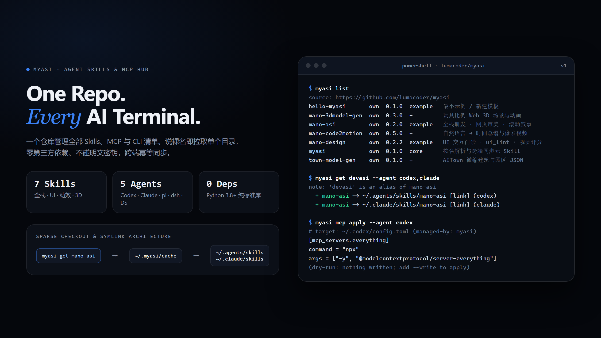

<div align="center">

# myasi

**一个仓库，按名同步你的全部 AI Agent Skills、MCP 配置与 CLI 清单。**

[](https://github.com/lumacoder/myasi/actions/workflows/ci.yml)


[快速开始](#-快速开始) · [内置 Skills](#-内置-skills-全景) · [使用方法](#-使用方法) · [MCP 与 CLI 同步](#-mcp-与-cli-同步) · [自建 Skill](#-添加你自己的-skill) · [设计文档](docs/DESIGN.md)

<br />



</div>

---

> **寓意：我的超级人工智能（My ASI）。**  
> 换电脑、换终端、换编程 Agent 时，不再到处复制散落的提示词与 JSON。只需说出裸名（如 `mano-asi`），`myasi` 自动按需稀疏拉取单个目录并跨端链接就位。

## ✨ 核心特性

- **单一总仓（Monorepo）**：将自有 `skills/`、第三方索引 `catalog/external.yaml`、环境配置 `mcp/servers.yaml` 与 `cli/` 装机清单统一托管，告别「一个 skill 一个仓库」的碎片化维护。
- **只说裸名，精确解析**：`registry.json` 自动建立裸名与别名索引（如 `devasi → mano-asi`、`hello → hello-myasi`）；拼错时给出最接近的 3 个候选且**绝不半途写入磁盘**。
- **按需只拉一个目录**：有 `git` 时使用 `--filter=blob:none` + `sparse-checkout`；无 `git` 时下载 tarball 仅解压目标 skill 目录，秒级完成，不克隆整仓。
- **真正零依赖，全平台通用**：`myasi` 为 Python 3.8+ 纯标准库单文件，原生支持 Windows（免管理员 `mklink /J` 目录联接，失败自动回退拷贝）、macOS 与 Linux。
- **密钥零落地**：MCP 唯一真源仅保存 `${ENV_VAR}` 占位符，自动编译为 Codex TOML `env_vars`、Claude CLI 命令及 Cursor / Gemini / DeepSeek JSON；仅清理自己托管的条目。
- **内置生产级工程技能包**：开箱即用 **7 个高内聚 Skill**，覆盖全栈研发、**Scrolltide 级网页审美与滚动叙事**、UI 交互/视觉双门禁、代码生成视频动效及 Web 3D 场景构建。

---

## 🚀 快速开始

### 1. 安装 `myasi` CLI

**Windows（PowerShell）**：
```powershell
irm https://raw.githubusercontent.com/lumacoder/myasi/main/scripts/install.ps1 | iex
myasi get mano-asi
```

**macOS / Linux / Git Bash**：
```bash
curl -fsSL https://raw.githubusercontent.com/lumacoder/myasi/main/scripts/install.sh | sh
export PATH="$HOME/.myasi/bin:$PATH"    # 写入 ~/.bashrc 或 ~/.zshrc 永久生效
myasi get mano-asi
```

> 安装脚本只下载 `myasi.py` 与包装脚本到 `~/.myasi/bin`，不克隆整个仓库。若仓库为私有，先设置只读凭据 `$env:GITHUB_TOKEN="..."`（PowerShell）或 `export GITHUB_TOKEN=...`（bash）；国内网络可通过 `MYASI_RAW_URL` 指定镜像源。

### 2. 不用 `myasi` 也可按名安装

```bash
# Vercel Skills CLI
npx skills add lumacoder/myasi --skill mano-asi -g -a codex -y

# Claude Code 插件市场
/plugin marketplace add lumacoder/myasi
/plugin install mano-asi@myasi
```

### 3. 常用第一条命令

```bash
myasi list                             # 查看全部可用 skills、版本、profile 与安装状态
myasi info mano-asi                    # 查看详情（支持别名：myasi info devasi）
myasi get mano-asi                     # 同时链接到 ~/.agents/skills 与 ~/.claude/skills
myasi sync                             # 按 profiles/clients.yaml 一键幂等对齐本机环境
```

---

## 🧩 内置 Skills 全景


| Skill | 别名 | 版本 | Profile | 大小 | 核心能力与定位 | 入口 |
|---|---|---|---|---|---|---|
| **`mano-asi`** | `devasi` | `0.2.0` | `example` | 212 KB | **全栈研发 & 网页审美工程师**：含 317 站实测网页审美规范、单一 `rAF` 滚动模式、60 条开源案例库与 Playwright 全轨迹验屏 `scrollshot.mjs` | [SKILL.md](skills/mano-asi/SKILL.md) |
| **`mano-design`** | — | `0.2.2` | `example` | 462 KB | **UI 交互与视觉双门禁**：17 类原型识别、51 个领域签名、组件选型规则、`ui_lint` / `browser_check`（110 自测用例）与 ≥8 分视觉评分门禁 | [SKILL.md](skills/mano-design/SKILL.md) |
| **`mano-code2motion`** | — | `0.5.0` | — | 395 KB | **代码创作动画与视频**：时间总谱先行、导演简报、18 仓库机制精华、风险设计帧对照与三门独立像素审阅 | [SKILL.md](skills/mano-code2motion/SKILL.md) |
| **`mano-3dmodel-gen`** | — | `0.3.0` | — | 21 KB | **Web 3D 玩具比例工作流**：自然语言 → 场景规格 → Three.js / WebGL2 纯函数时间轴 `render(t)` 与碰撞放置验收 | [SKILL.md](skills/mano-3dmodel-gen/SKILL.md) |
| **`myasi`** | — | `0.1.0` | `core` | 2 KB | **按名解析与跨端同步元 Skill**：教 Agent 自动查重、按别名拉取 skill 并安全预览/应用 MCP 配置 | [SKILL.md](skills/myasi/SKILL.md) |
| **`town-model-gen`** | — | `0.1.0` | — | 66 KB | **AITown 建筑与园区 JSON**：根据描述或参考图生成带 Schema 校验的微缩建筑、街景与大型园区模型 | [SKILL.md](skills/town-model-gen/SKILL.md) |
| **`hello-myasi`** | `hello` | `0.1.0` | `example` | 1 KB | **最小参考模板**：演示 `get / update / remove` 闭环及新建 skill 标准目录结构 | [SKILL.md](skills/hello-myasi/SKILL.md) |

### 重点介绍：`mano-asi` 网页审美与滚动叙事能力

为了让 AI 生成的官网、产品页与作品集摆脱「堆砌区块 + 处处淡入 + 紫蓝渐变」的模板味，`mano-asi` 融合了 [scrolltide/ai-studio-skill](https://github.com/scrolltide/ai-studio-skill)（MIT 部分）的工程精髓：

- **审美规范（[`rules/web-craft.md`](skills/mano-asi/rules/web-craft.md)）**：动笔先定「一句主角时刻」；深墨/暖石舞台底色（防首屏白闪）、`.apron` 无缝退场、全页单一强调色、流体 `clamp` 字阶配唯一 1 个斜体衬线词、`tabular-nums` 动态数字、定时曲线与滚动数学严格分离。
- **原生模式库（[`patterns/INDEX.md`](skills/mano-asi/patterns/INDEX.md)）**：提供可直接落地的 Vanilla / React / Next.js 代码模式——单一 `rAF` 引擎 + Lenis（`engine.md`）、WebP 帧序列 Canvas + Fritsch–Carlson 速度曲线 / 同源分层视差 / SVG 自绘路径 / 横向胶片卷（`stages.md`）、`fitText` 实测字标与无 JS 不白屏显隐（`surface-and-type.md`）。
- **全滚动轨迹验屏（[`scripts/scrollshot.mjs`](skills/mano-asi/scripts/scrollshot.mjs)）**：支持对开发服务器、`dist/` 或单文件 HTML 在桌面（`1440×900`）与手机（`390×844`）及 `prefers-reduced-motion: reduce` 下按 `0/25/50/75/100%` 截屏并输出 `report.json`，自动捕获卡死舞台、横向溢出、字体回退与外链资源。

---

## 🛠 使用方法

### Skill 安装、同步与维护

```bash
# 检索与查看
myasi list [--tag web] [--profile core] [--installed] [--json]
myasi search 滚动                      # 按名称、别名、标签、简介搜索
myasi info devasi                      # 通过别名查看 mano-asi 完整元数据

# 安装与更新
myasi get mano-asi                     # 默认链接安装到全部支持端
myasi get mano-asi --agent codex       # 指定端：codex | claude | pi | dsh | deepseek | all（支持逗号组合）
myasi get mano-asi --copy              # 使用独立拷贝而非目录链接（默认 --link 指向 ~/.myasi/cache）
myasi get --profile core,example       # 按 profile 批量安装
myasi get <第三方名> --yes             # 第三方 skill（catalog/external.yaml）需 --yes 确认许可
myasi update [name]                    # 回到当初记录的 source_spec 拉取最新提交

# 同步、诊断与卸载
myasi sync [--prune]                   # 按 profiles/clients.yaml 幂等对齐（--prune 清理多余托管项）
myasi doctor [--strict]                # 检查失效链接、旧路径同名冲突与安装状态
myasi remove mano-asi [--agent claude] # 仅删除 myasi 自己安装的目录/链接
```

### 切换来源仓库与分支

来源默认为 `lumacoder/myasi`；可通过 `--source` 或环境变量 `MYASI_SOURCE` 指向任意 `owner/name`、Git URL、`file://` URL、本地裸仓库或当前克隆（在仓库内直接运行 `bin/myasi` 时自动使用本地克隆）。`--ref` / `MYASI_REF` 指定分支或标签，`MYASI_AGENT` 设定默认端。安装状态持久化在 `~/.myasi/state.json`。

### 各 Agent 端支持矩阵

| 客户端 | Skill 安装目录 | 调用方式 | MCP 同步（`myasi mcp apply`） |
|---|---|---|---|
| **Codex** | `~/.agents/skills` | `$name`、`/skills` | ✅ 更新 `~/.codex/config.toml` 的 `managed-by: myasi` 区块，密钥转为 `env_vars` |
| **Claude Code** | `~/.claude/skills` | `/name` | ✅ 生成并执行 `claude mcp add-json … -s user`（加 `--write` 时执行） |
| **pi** | `~/.agents/skills` | `/skill:name` | ⏳ 需扩展支持，当前仅打印中性 JSON |
| **DeepSeek Harness (`dsh`)** | `~/.agents/skills` | 自动加载 | ⏳ 配置字段待实测，当前仅打印中性 JSON |
| **deepseek TUI** | `~/.agents/skills`（兼容 `~/.claude/skills`） | 自动加载 | ✅ 合并写入 `~/.deepseek/mcp.json` |
| **Cursor / Gemini CLI** | — | — | ✅ 分别写入 `~/.cursor/mcp.json`（`${env:VAR}`）与 `~/.gemini/settings.json` |

> **说明**：Codex、pi、dsh、deepseek TUI 共用 `~/.agents/skills`，同一 skill 只存储一份；Windows 下优先使用无需管理员权限的目录联接（`mklink /J`），失败时自动退回拷贝模式。

---

## 🔌 MCP 与 CLI 同步

### MCP 配置同步（唯一真源：`mcp/servers.yaml`）

```bash
myasi mcp apply --agent codex          # 默认 dry-run 预览，不改动本机文件
myasi mcp apply --agent codex --write  # 确认无误后写入目标配置
myasi mcp apply --agent all --include-unverified
```

- `mcp/servers.yaml` 内所有密钥只写 `${ENV_VAR}` 占位符，由 `validate.py` 强制拦截明文密钥。
- `verified: false` 的示例条目默认跳过，防止未配置的服务误写入环境。

### CLI 装机清单（`cli/`）

```bash
myasi cli                              # 预览当前系统的装机命令（dry-run）
myasi cli --os windows --run           # 实际执行 winget / npm / uv / brew 清单安装
```

清单位置：[`cli/windows/winget.json`](cli/windows/winget.json)、[`cli/macos/Brewfile`](cli/macos/Brewfile)、[`cli/npm/global.txt`](cli/npm/global.txt)、[`cli/uv/tools.txt`](cli/uv/tools.txt)。

---

## 🧱 添加你自己的 Skill

1. **生成标准骨架**（自动同步更新 `registry.json` 与 `.claude-plugin/marketplace.json`）：
   ```bash
   git clone https://github.com/lumacoder/myasi && cd myasi
   python scripts/myasi.py new my-skill -d "一句话说明触发时机（Agent 仅据此决定是否加载）" --tags dev --alias old-name
   ```
   将生成 `skills/my-skill/SKILL.md`、`skill.json` 与 `agents/openai.yaml`。规范要求：目录名用 `kebab-case`，frontmatter `name` 必须等于目录名，`description` ≤ 1024 字符，单个 skill 总大小 ≤ 5 MB。
2. **编写规范与分配 Profile**：完善 `SKILL.md` 正文；如需默认同步安装，把裸名加入 [`profiles/core.txt`](profiles/core.txt) 或 [`profiles/example.txt`](profiles/example.txt)（由 [`profiles/clients.yaml`](profiles/clients.yaml) 绑定各端）。第三方上游 skill 请登记到 [`catalog/external.yaml`](catalog/external.yaml)，不直接拷贝源码。
3. **生成索引、静态校验与单测**：
   ```bash
   python scripts/build_registry.py && python scripts/validate.py && python -m unittest discover -s tests
   ```
   > **硬约束**：`registry.json` 与 `.claude-plugin/marketplace.json` 由脚本生成，切勿手改；严禁提交 `.zip`、构建产物、`__pycache__`、`.env` 或任何明文凭证。
4. **本地隔离冒烟试装**：
   ```bash
   python scripts/myasi.py get my-skill --source .
   ```

---

## 📐 仓库结构

```text
myasi/
├── registry.json                     # 裸名 → 元数据与别名索引（build_registry.py 生成）
├── .claude-plugin/marketplace.json   # Claude Code 插件市场清单（build_registry.py 生成）
├── skills/                           # 自有 Skills 唯一真源（含 mano-asi / mano-design / mano-code2motion 等）
├── catalog/external.yaml             # 第三方 Skill 索引（仅记 repo/path/license，不拷贝源码）
├── profiles/                         # core.txt / example.txt 与 clients.yaml 端配置映射
├── mcp/servers.yaml                  # MCP 唯一真源（仅含 ${ENV} 引用）
├── cli/                              # winget / Brewfile / npm / uv 装机清单
├── bin/                              # myasi（sh）与 myasi.cmd（Windows）入口脚本
├── scripts/                          # myasi.py、build_registry.py、validate.py、install.sh/ps1
├── tests/                            # 标准库单元测试与跨端端到端测试
├── docs/
│   ├── DESIGN.md                     # 架构与协议设计说明
│   └── assets/                       # README 展示截图
├── AGENTS.md / CLAUDE.md             # 给编程 Agent 的按名解析与开发约束
└── .github/workflows/ci.yml          # validate + Python 3.8/3.12 单测 + gitleaks + 三平台冒烟
```

---

## 📄 许可证与致谢

- 本仓库主体代码与自有指令规范采用 **[MIT License](LICENSE)**。
- 第三方引用：
  - `skills/mano-asi` 的网页审美规范、原生滚动模式与 `scrollshot.mjs` 适配自 [scrolltide/ai-studio-skill](https://github.com/scrolltide/ai-studio-skill) 的 **MIT** 开源部分（未包含其专有 `library/*.md` 模板与下载资产）。
  - `skills/mano-design` 的视觉卫生与双门禁思路借鉴了 `heydamir/unslop`（CC BY 4.0）、`anthropics/skills`、`Nutlope/hallmark` 等开源设计技能；`skills/mano-3dmodel-gen` 提炼自 `Nyxera0x/simulator`（MIT）。
  - 登记在 `catalog/external.yaml` 中的第三方 skill 以各自上游仓库许可证为准。
